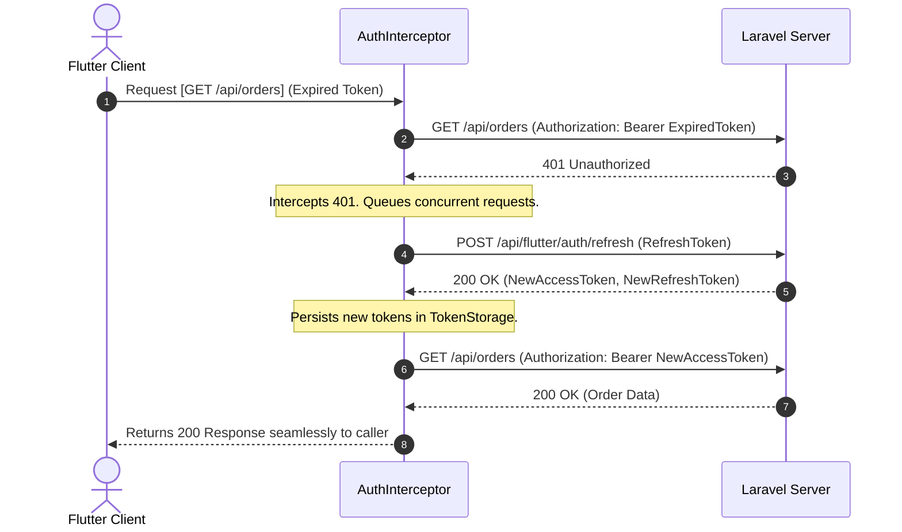
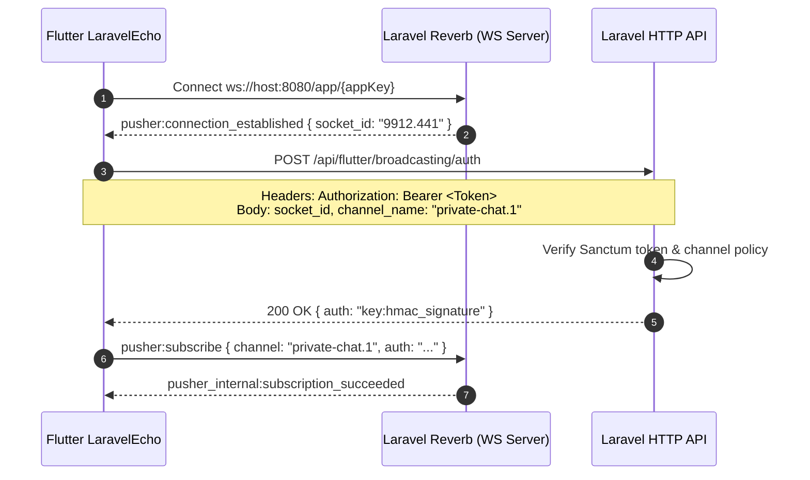

# Architecture & Protocol Specification

## 1. Architectural Philosophy

The **Laravel & Flutter Bridge Suite** follows strict enterprise architecture principles:
- **Contract-First Communication**: Predictable JSON response envelopes across all endpoints.
- **Fail-Safe Token Management**: Graceful token renewal without interrupting the active user session or triggering UI jitter.
- **Protocol Independence**: WebSockets conform to the Pusher/Reverb protocol standard without requiring proprietary native binary drivers.
- **Offline Resilience**: Idempotent mutation queueing to ensure operations performed during network dropouts are never lost.
- **Zero-Friction Scaffolding**: Automated CLI code reflection keeps Dart models in sync with Laravel database schemas.

---

## 2. Standardized API Response Envelope

Every endpoint routed through the bridge returns a consistent JSON envelope schema:

### 2.1 Success Envelope (HTTP 200 / 201)
```json
{
  "success": true,
  "message": "Resource retrieved successfully",
  "data": {
    "id": 101,
    "name": "Acme Enterprise Corp",
    "status": "active"
  },
  "errors": null,
  "meta": {
    "timestamp": "2026-11-09T19:30:00Z",
    "api_version": "v1",
    "trace_id": "9b1deb4d-3b7d-4bad-9bdd-2b0d7b3dcb6d"
  }
}
```

### 2.2 Paginated Envelope (HTTP 200)
```json
{
  "success": true,
  "message": "Data retrieved successfully",
  "data": [
    { "id": 1, "title": "Article 1" },
    { "id": 2, "title": "Article 2" }
  ],
  "errors": null,
  "meta": {
    "current_page": 1,
    "last_page": 10,
    "per_page": 15,
    "total": 150,
    "has_more": true,
    "next_page_url": "https://api.domain.com/api/posts?page=2",
    "prev_page_url": null,
    "timestamp": "2026-11-09T19:30:00Z",
    "api_version": "v1",
    "trace_id": "0df81e7d-cba7-47b7-8276-8051772fb2ec"
  }
}
```

### 2.3 Form Validation Error Envelope (HTTP 422)
```json
{
  "success": false,
  "message": "The given data was invalid.",
  "data": null,
  "errors": {
    "email": [
      "The email field is required.",
      "The email must be a valid email address."
    ],
    "password": [
      "The password must be at least 8 characters."
    ]
  },
  "meta": {
    "timestamp": "2026-11-09T19:30:00Z",
    "api_version": "v1",
    "trace_id": "278c772b-2a91-4e78-98e3-0d31481e138a"
  }
}
```

---

## 3. Detailed Sequence Diagrams

### 3.1 Seamless Auto-Refresh Token Cycle
When a token expires, the client holds pending requests in memory, renews the token, and replays all queued calls transparently:



### 3.2 WebSocket Broadcast Authorization Cycle
Allows mobile clients to authorize private channels using standard Bearer tokens without CSRF session cookies:


