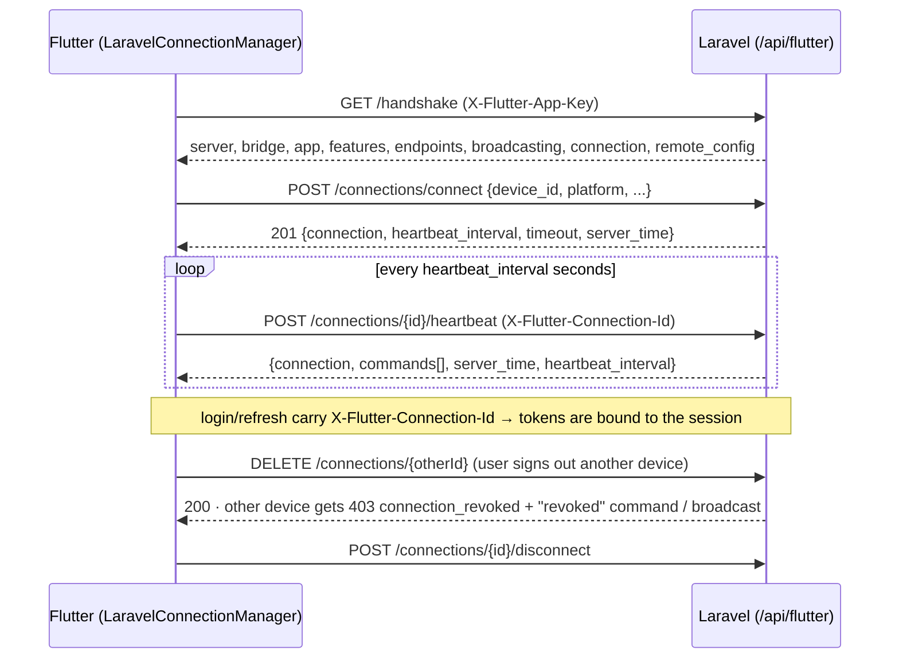

# Connection Management Protocol (Bridge v2)

This document is the **wire contract** between `atannex/laravel-flutter-bridge` (server) and
`flutter_laravel_bridge` (client). Both packages implement exactly what is written here. Bridge
protocol version: **`2.0.0`**.

A *connection* has two meanings, and the protocol handles both:

| Term | Lives in | Meaning |
| :--- | :--- | :--- |
| **Connection profile** | Flutter only | A saved backend target the user can add, test, edit, switch to and delete (name, base URL, app key, prefix). |
| **Connection session** | Laravel DB (`flutter_connections`) | A live link between one device/app install and the server, kept alive by heartbeats, listed and revocable by the user and by admins. |
| **Client app** | Laravel DB (`flutter_apps`) | A registered Flutter application identified by an app key, carrying version policy (min / latest version) and remote settings. |

---

## 1. Lifecycle



---

## 2. Headers

Client → server (attached to **every** request by the Flutter client):

| Header | Value |
| :--- | :--- |
| `Accept` | `application/json` |
| `X-Flutter-Platform` | `android` · `ios` · `web` · `macos` · `windows` · `linux` · `fuchsia` |
| `X-Flutter-App-Version` | app semver, e.g. `1.4.2` |
| `X-Flutter-Device-Id` | stable install/device id |
| `X-Flutter-Bridge-Version` | client package version, `2.0.0` |
| `X-Flutter-App-Key` | app key from `flutter_apps.key` (when configured) |
| `X-Flutter-Connection-Id` | id of the current connection session (after connect) |
| `Authorization` | `Bearer <access_token>` (when logged in) |

Server → client (on every bridge response):

| Header | Value |
| :--- | :--- |
| `X-Laravel-Flutter-Bridge` | server package version, `2.0.0` |
| `X-Flutter-Server-Time` | ISO-8601 server time |

---

## 3. Response envelope & error codes

Every bridge response uses the envelope:

```json
{ "success": true, "message": "…", "data": { }, "errors": null,
  "meta": { "timestamp": "…", "api_version": "v1", "trace_id": "…" } }
```

Protocol-level failures add `meta.error_code`. Clients must branch on the code, not on the message.

| HTTP | `meta.error_code` | When | Client behaviour |
| :--- | :--- | :--- | :--- |
| 400 | `invalid_two_factor_session` | unknown/expired/locked `two_factor_token` on `auth/2fa/verify` | request a new code |
| 400 | `two_factor_locked` | too many wrong 2FA codes (`two_factor.max_attempts`, default 5); the challenge is destroyed and the same `two_factor_token` now answers 400 `invalid_two_factor_session` | ask the user to request a new code (`auth/2fa/send-otp`) |
| 401 | `unauthenticated` | missing/expired access token | try refresh once, else session expired |
| 401 | `invalid_refresh_token` | refresh token unknown/expired/revoked | **no refresh retry**; clear tokens |
| 401 | `refresh_token_reused` | a rotated refresh token was replayed; whole token family revoked | **no refresh retry**; clear tokens |
| 403 | `app_key_required` | `require_app_key` on and header missing | status `failed` |
| 403 | `invalid_app_key` | unknown app key | status `failed` |
| 403 | `app_suspended` | app status is `suspended` | status `failed` |
| 403 | `connection_revoked` | `X-Flutter-Connection-Id` points to a revoked session | **no refresh retry**; clear tokens; status `revoked` |
| 404 | `connection_not_found` | unknown connection id on connection routes | reconnect (new session) |
| 422 | `validation_failed` | validation error; `errors` = `{field: [messages]}` | surface field errors |
| 422 | `two_factor_required` | `auth/login` or `auth/social` for an account with an authenticator app, sent without `code` / `recovery_code`; `data` = `{"two_factor": true}`, `errors` = `{"code": ["…"]}`; no tokens issued | ask for the authenticator-app code (or a recovery code) and resend the same request with `code` / `recovery_code` |
| 422 | `two_factor_invalid` | `code` / `recovery_code` was wrong (same shape as `two_factor_required`) | show the error on the code field and let the user retry |
| 426 | `upgrade_required` | `X-Flutter-App-Version` < min version | status `upgradeRequired`; `errors` = `{current_version, min_version, latest_version, update_url}` |
| 429 | `too_many_requests` | throttled; `Retry-After` header | back off |
| 503 | `maintenance` | app in maintenance mode | back off / show banner |

`/ping` and `/handshake` are exempt from the version check (426) so an outdated client can still
discover the update URL.

Every route is rate limited (per minute, configurable under `flutter-bridge.rate_limits`; a limit of
`0`/`null` disables it). Throttled requests get the 429 `too_many_requests` envelope with `Retry-After`
(seconds); clients should wait that long before retrying.

| Limiter | Routes | Default | Keyed by |
| :--- | :--- | :--- | :--- |
| `flutter-auth` | `auth.login`, `auth.register`, `auth.social`, `auth.2fa.send` | 5 + 30 | email + IP, and IP |
| `flutter-2fa` | `auth.2fa.verify` | 10 | IP |
| `flutter-refresh` | `auth.refresh` | 20 | IP |
| `flutter-connect` | `connections.connect` | 10 | `device_id` + IP |
| `flutter-heartbeat` | `connections.heartbeat`, `connections.disconnect` | 12 | connection id |
| `flutter-api` | all other routes | 120 | user id, or IP for guests |

---

## 4. Endpoints

All paths are relative to the base URL and prefixed with `flutter-bridge.prefix` (default
`api/flutter`). The **handshake returns this table as `endpoints`**, so clients should resolve paths
from it instead of hard-coding them. Placeholders use `{name}` syntax.

| Key | Method | Path | Auth |
| :--- | :--- | :--- | :--- |
| `ping` | GET | `ping` | public |
| `handshake` | GET | `handshake` | public |
| `config` | GET | `config` | public |
| `auth.login` | POST | `auth/login` | public |
| `auth.register` | POST | `auth/register` | public |
| `auth.social` | POST | `auth/social` | public |
| `auth.refresh` | POST | `auth/refresh` | public (refresh token in body) |
| `auth.2fa.send` | POST | `auth/2fa/send-otp` | public |
| `auth.2fa.verify` | POST | `auth/2fa/verify` | public |
| `auth.me` | GET | `auth/me` | bearer |
| `auth.logout` | POST | `auth/logout` | bearer |
| `devices.register` | POST | `devices/register` | optional bearer |
| `devices.unregister` | DELETE | `devices/{device}` | optional bearer |
| `broadcasting.auth` | POST | `broadcasting/auth` | bearer |
| `connections.connect` | POST | `connections/connect` | optional bearer |
| `connections.heartbeat` | POST | `connections/{connection}/heartbeat` | optional bearer |
| `connections.disconnect` | POST | `connections/{connection}/disconnect` | optional bearer |
| `connections.index` | GET | `connections` | bearer |
| `connections.revoke` | DELETE | `connections/{connection}` | bearer |
| `connections.revoke_others` | DELETE | `connections` | bearer |

"optional bearer" = the route is public, but if a valid bearer token is sent the user is resolved
(via the configured guard) and linked.

### 4.1 `GET handshake`

```json
{
  "server": { "name": "Acme", "environment": "production", "url": "https://api.acme.com",
              "timezone": "UTC", "locale": "en", "time": "2026-11-09T10:00:00+00:00" },
  "bridge": { "version": "2.0.0", "api_version": "v1", "prefix": "api/flutter" },
  "app": { "key": "fba_…", "name": "Acme iOS", "status": "active",
           "min_version": "1.2.0", "latest_version": "1.5.0", "update_url": "https://…",
           "platforms": ["ios","android"], "settings": {} },
  "features": { "auth": true, "registration": true, "social_auth": true, "two_factor": true,
                "devices": true, "broadcasting": true, "connections": true, "push": true },
  "endpoints": { "ping": "api/flutter/ping", "connections.heartbeat": "api/flutter/connections/{connection}/heartbeat", "…": "…" },
  "broadcasting": { "driver": "reverb", "key": "app-key", "host": "ws.acme.com", "port": 443,
                    "scheme": "https", "cluster": null,
                    "auth_endpoint": "api/flutter/broadcasting/auth",
                    "connection_channel": "private-flutter.connections.{connection}",
                    "user_channel": "private-users.{user}" },
  "connection": { "heartbeat_interval": 30, "timeout": 90 },
  "remote_config": { "any": "value" }
}
```

`app` is `null` when no app key was sent. `broadcasting` is `null` when broadcasting is disabled or
the driver is not `reverb`/`pusher`.

### 4.2 `GET ping`

`{ "pong": true, "server_time": "…" }` — used for latency measurement.

### 4.3 `GET config`

`data` = the `remote_config` object (server config merged with the app's `settings`).

### 4.4 `POST connections/connect`

Request:

```json
{ "device_id": "required|string|max:255", "platform": "required|in:android,ios,web,macos,windows,linux,fuchsia",
  "app_version": "nullable", "device_name": "nullable", "os_version": "nullable",
  "fcm_token": "nullable", "bridge_version": "nullable", "metadata": "nullable|array" }
```

Server behaviour:

* Resolves the app from `X-Flutter-App-Key` (nullable) and the user from the optional bearer token.
* If a non-revoked session for the same `(app_id, device_id)` exists it is **resumed** (status set back to
  `active`, `connected_at` kept, attributes refreshed). Otherwise a new session with a UUID id is created.
* Upserts the `flutter_devices` row for `device_id` (attaching the user if known).
* Fires `FlutterConnectionEstablished`.

Response **201** (new) or **200** (resumed):

```json
{ "connection": { …Connection… }, "heartbeat_interval": 30, "timeout": 90, "server_time": "…" }
```

### 4.5 Connection object

```json
{ "id": "9b1d…uuid", "app_key": "fba_…", "user_id": 1, "device_id": "abc", "platform": "android",
  "device_name": "Pixel 9", "app_version": "1.4.2", "os_version": "15", "ip_address": "10.0.0.5",
  "user_agent": "…", "status": "active", "is_online": true, "is_current": true,
  "connected_at": "…", "last_seen_at": "…", "disconnected_at": null, "revoked_at": null,
  "metadata": {} }
```

`status` ∈ `active` · `disconnected` · `revoked`. `is_online` = `status == active` and
`last_seen_at` within `timeout` seconds. `is_current` = id equals the request's
`X-Flutter-Connection-Id`.

### 4.6 `POST connections/{connection}/heartbeat`

Request (all optional): `{ "state": "foreground|background", "fcm_token": "…", "metadata": {} }`

Behaviour: touches `last_seen_at`, re-activates a `disconnected` session, links the user if a bearer
token is present and the session has none, and returns **and marks delivered** all pending, non-expired
commands.

Response:

```json
{ "connection": { … }, "commands": [ { "id": "12", "type": "message", "payload": {"title":"Hi"},
  "created_at": "…" } ], "server_time": "…", "heartbeat_interval": 30 }
```

Revoked session → 403 `connection_revoked`. Unknown id → 404 `connection_not_found`.

### 4.7 `POST connections/{connection}/disconnect`

Marks the session `disconnected` (`disconnected_at` = now) and fires `FlutterConnectionDisconnected`.
Returns `{ "connection": {…} }`.

### 4.8 `GET connections` (bearer)

All sessions of the authenticated user, newest activity first: `{ "connections": [ … ] }`. Query
`?status=active` filters.

### 4.9 `DELETE connections/{connection}` (bearer)

Revokes one of the user's sessions (404 if it belongs to someone else). Revoking a session:

1. sets `status = revoked`, `revoked_at = now`;
2. revokes every refresh token bound to it and deletes the Sanctum access tokens they reference;
3. queues a `revoked` command;
4. fires `FlutterConnectionRevoked` (broadcast as `ConnectionRevoked` on
   `private-flutter.connections.{id}` when broadcasting is enabled).

Returns `{ "connection": {…} }`.

### 4.10 `DELETE connections` (bearer)

Revokes every active session of the user **except** the current one (`X-Flutter-Connection-Id`).
Returns `{ "revoked": 3 }`.

---

## 5. Server → client commands

Commands are queued in `flutter_connection_commands`, delivered in the next heartbeat response, and —
when broadcasting is on — pushed instantly as event `BridgeCommand` on
`private-flutter.connections.{id}` (payload = the command object). The client de-duplicates by `id`.

| `type` | Payload | Built-in client handling |
| :--- | :--- | :--- |
| `revoked` | `{reason?}` | clear tokens, status `revoked`, `onSessionRevoked` |
| `logout` | `{reason?}` | clear tokens, auth → Unauthenticated |
| `refresh_config` | `{}` | re-run handshake, update `ServerInfo` |
| `force_update` | `{min_version?, update_url?}` | status `upgradeRequired` |
| `message` | `{title, body, …}` | emitted on `commands` stream only |
| anything else | free | emitted on `commands` stream only |

---

## 6. Authentication changes (bound tokens & real refresh rotation)

`authorization` object returned by login / register / social / 2fa verify / refresh:

```json
{ "token_type": "Bearer", "access_token": "1|…", "refresh_token": "80-char", "expires_in": 3600,
  "expires_at": "…", "refresh_expires_at": "…" }
```

* Refresh tokens are stored **hashed** (sha256) in `flutter_refresh_tokens` with `user_id`,
  `access_token_id`, `connection_id`, `device_id`, `expires_at`, `revoked_at`.
* `POST auth/refresh {refresh_token}` is **public**. Valid token → old refresh token revoked, old access
  token deleted, new pair issued (rotation). Replayed revoked token → every refresh token of that
  user+device is revoked, 401 `refresh_token_reused`. Unknown/expired → 401 `invalid_refresh_token`.
* When `X-Flutter-Connection-Id` is present on login/refresh the tokens are bound to that session and the
  session's `user_id` is set. `single_session_per_device` revokes earlier tokens of the same device.
* `POST auth/logout` revokes the current access token and its refresh token(s).
* `POST auth/login` (and `POST auth/social`) accept optional `code` (6-digit authenticator-app code,
  whitespace ignored) and `recovery_code`. For accounts with an authenticator app the first attempt
  answers 422 `two_factor_required`; the client resends the same body plus `code` or `recovery_code`.
  A recovery code works once. Tokens are only issued after the check passes. Controlled by
  `flutter-bridge.auth.two_factor_challenge` (`auto` = when Laravel Fortify is installed and the user
  has a (confirmed) two-factor secret). This is separate from the email one-time-code endpoints
  `auth/2fa/send-otp` / `auth/2fa/verify`, which are unchanged.
* Servers may plug in their own sign-in (`auth.authenticate_using`, or Fortify's
  `authenticateUsing`), sign-up (`auth.register_using`, or Fortify's `CreatesNewUsers`) and `user`
  shape (`auth.user_presenter`). With a custom sign-in the `email` field is no longer required by the
  bridge (the app's authenticator reads its own fields); `password` still is. With a custom sign-up
  every request field is passed to the app's action, which applies its own validation (422
  `validation_failed`).

---

## 7. Client apps & version policy

`flutter_apps`: `name`, `key` (`fba_` + 40 random chars, unique), `status` (`active|suspended`),
`platforms` (json, null = all), `min_version`, `latest_version`, `update_url`, `settings` (json),
`last_connected_at`.

Version check: effective min version = `app.min_version` ?? `config('flutter-bridge.connections.min_app_version')`.
Compared with PHP `version_compare` against `X-Flutter-App-Version` (skipped when the header is absent).

Artisan: `flutter:apps`, `flutter:app:create`, `flutter:app:update`, `flutter:app:delete`,
`flutter:connections`, `flutter:connections:revoke`, `flutter:connections:send`,
`flutter:connections:prune`, `flutter:export-config`.
