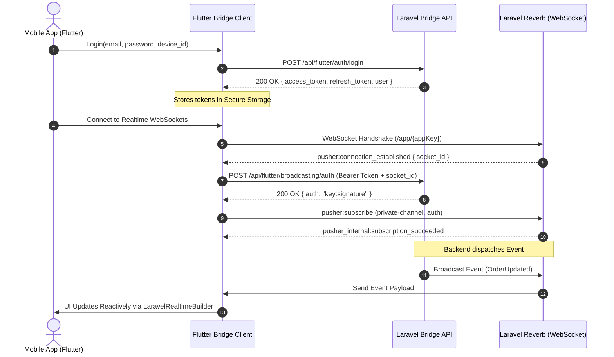

# Enterprise Laravel & Flutter Bridge Suite

Welcome to the **Enterprise Laravel & Flutter Bridge Suite** documentation. This suite provides a robust, two-way, battle-tested communication bridge between a **Laravel** backend and a **Flutter** mobile/web application.

---

## 📁 Repository & Directory Layout

| Directory | Type | Purpose |
| :--- | :--- | :--- |
| [`laravel-flutter-bridge/`](https://github.com/atannex/laravel-flutter-bridge) | **PHP / Composer Package** | Laravel backend package providing Sanctum mobile device tokens, standardized response envelopes, Reverb/Pusher Bearer broadcast authentication, FCM device management, and Dart code generation. |
| [`flutter-laravel-bridge/`](https://github.com/atannex/flutter-laravel-bridge) | **Dart / Flutter Package** | Production Flutter client package built on Dio & WebSockets, providing reactive auth lifecycle, Reverb Echo client, typed Laravel validation error parsing, offline mutation queues, and infinite scroll pagination widgets. |
| [`docs/`](./) | **Documentation** | In-depth enterprise guides, architectural blueprints, sequence diagrams, and best practices. |

---

## 📚 Documentation Index

1. [**Architecture & Protocol Specification**](ARCHITECTURE.md)  
   Complete architectural overview, JSON envelope schemas, error codes, and sequence diagrams.
2. [**Laravel Backend Setup Guide**](LARAVEL_SETUP.md)  
   Step-by-step setup instructions for Laravel 12/13, Sanctum, Reverb, and migrations.
3. [**Flutter Client Setup Guide**](FLUTTER_SETUP.md)  
   Client initialization, dependency configuration, and Riverpod/Bloc integration examples.
4. [**Authentication & Token Lifecycle**](AUTHENTICATION.md)  
   Deep dive into device-bound tokens, auto-refresh token rotation, and 401 recovery queues.
5. [**Real-Time WebSockets & Laravel Reverb**](REALTIME_BROADCASTING.md)  
   Connecting Flutter to Laravel Reverb / Pusher with Bearer broadcast authorization for private and presence channels.
6. [**Push Notifications & Device Management**](PUSH_NOTIFICATIONS_AND_DEVICES.md)  
   Automatic FCM token synchronization, platform telemetry, and targeting users across devices.
7. [**Offline Mutation Queuing & Caching**](OFFLINE_AND_CACHING.md)  
   Resilient offline mutation replaying, cache policies (`networkFirst`, `cacheFirst`), and optimistic UI patterns.
8. [**Code & Contract Generation**](CODE_GENERATION.md)  
   Artisan commands for generating null-safe Dart models and type-safe API route registries from Laravel.
9. [**Enterprise Security & Hardening**](SECURITY_BEST_PRACTICES.md)  
   SSL Pinning, Android Keystore / iOS Keychain token encryption, rate limiting, and device revocation.
10. [**Fluent Query Builder**](QUERY_BUILDER.md)  
    Filtering, sorting, sparse fieldsets, and eager loading from Flutter to Laravel.
11. [**Native Push Notification Channel**](NOTIFICATIONS_CHANNEL.md)  
    Using Laravel's native notification system with the `flutter_push` driver.
12. [**Connection Management Protocol (v2)**](CONNECTIONS.md)  
    Handshake, live connection sessions, heartbeats, remote sign-out, server→client commands, app keys and version policy.
13. [**Troubleshooting & FAQ**](TROUBLESHOOTING.md)  
    Networking rules (10.0.2.2 vs localhost), CORS, Reverb firewall setup, and debugging 401 loops.

---

## ⚡ Fast Track: High-Level Architecture

